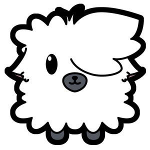
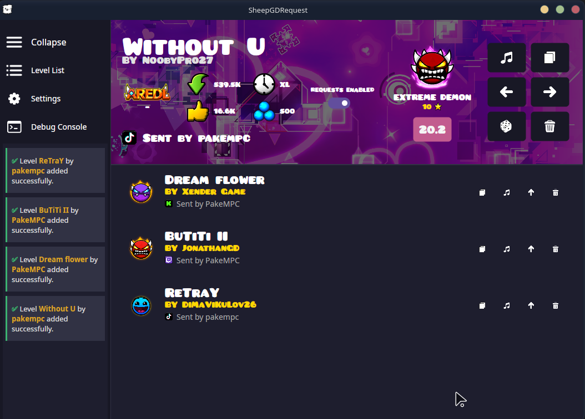
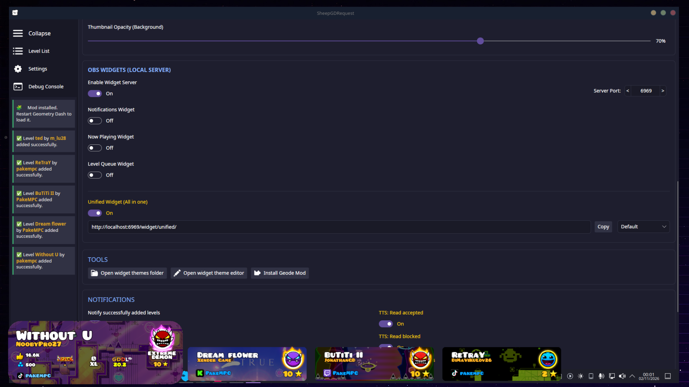
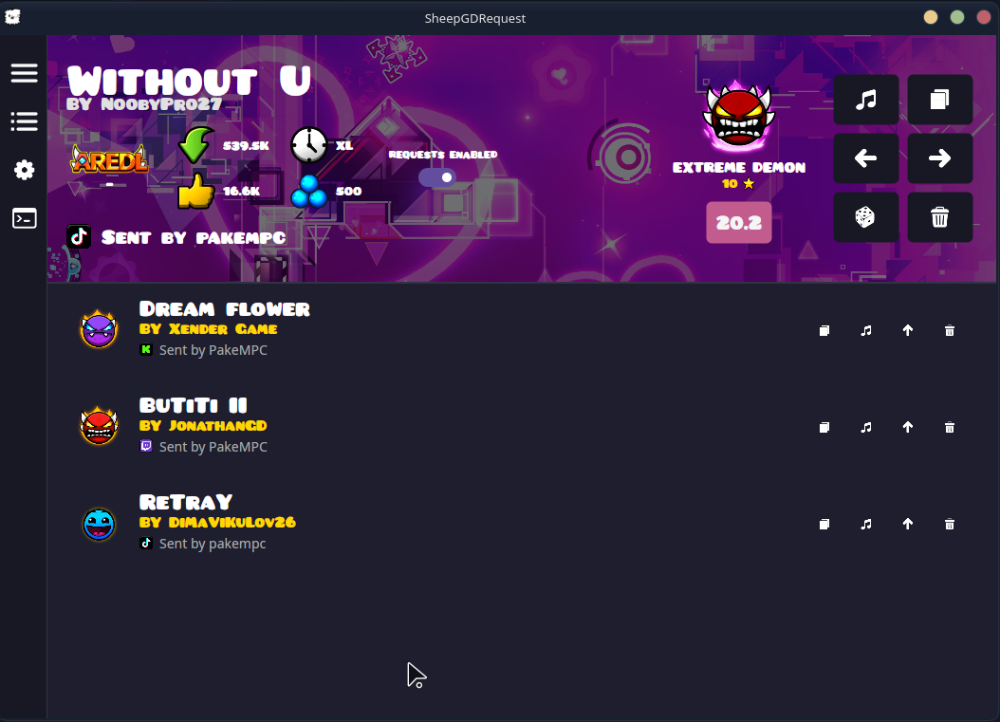
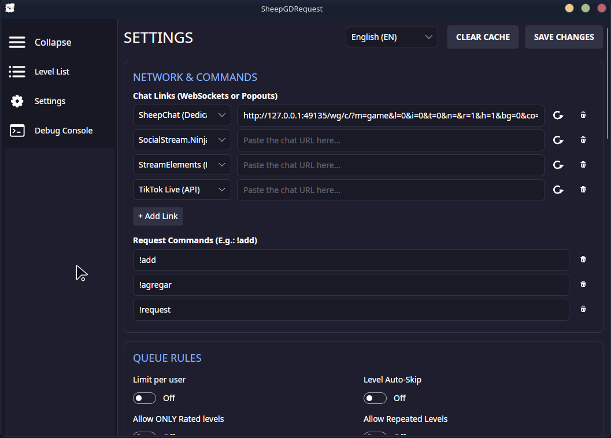
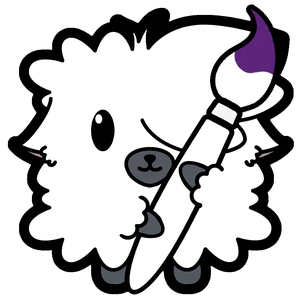
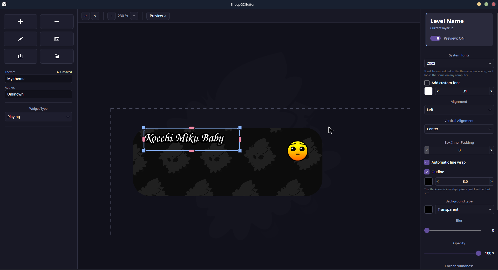
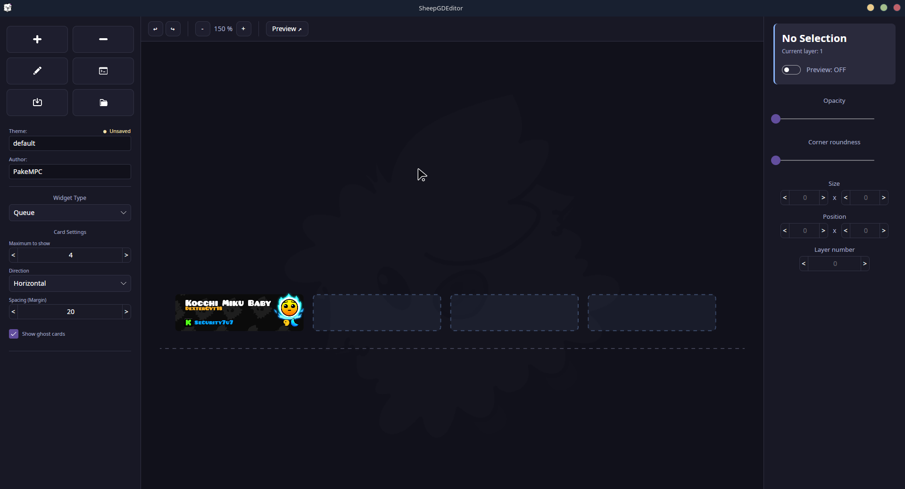
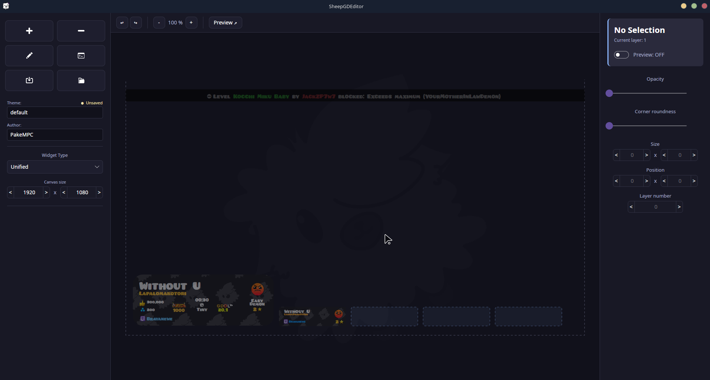
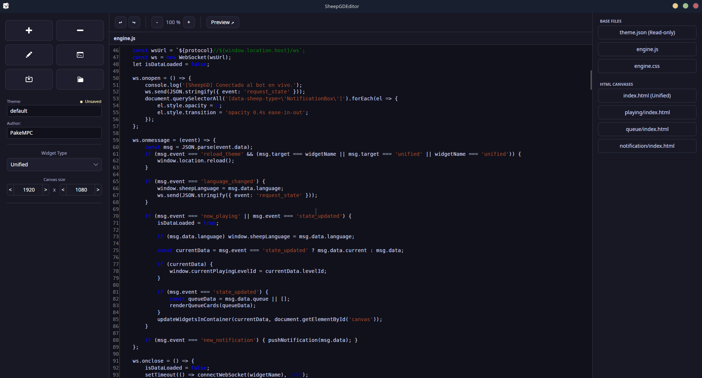

# SheepGDRequest



**Every level request from your Geometry Dash stream, in one place.** SheepGDRequest reads your
Twitch, YouTube, Kick, TikTok and Discord chats at the same time, filters what your viewers ask
for, looks up every level on GD and puts it in a queue you can run from the app, from OBS or from
inside the game itself.

Everything runs on your computer. No servers, no accounts, no subscriptions: the app, the OBS
widgets and the Geode mod share a single file, `queue_data.json`, and any of the three can move the
queue. Whatever you do in one shows up instantly in the other two.

<p align="center">
  
</p>

> **Play without leaving GD.** With the [SheepGDintegration](https://github.com/PakeMPC/SheepGDintegration)
> mod, the queue lives inside Geometry Dash: skip, remove or pick levels from the game, and
> auto-skip switches levels without ever leaving gameplay. The app installs it with one click and
> tells you when a new version is out.

## Features

**All your chats at once**

- **Twitch, YouTube, Kick, TikTok Live** and **Discord**, plus **SheepChat, SocialStream.Ninja,
  StreamElements** and **any other web chat**: up to ten links at the same time, in any mix. For
  Twitch, YouTube and Kick, just paste your channel link: no accounts or keys needed.
- If a source drops (the page reloads, the network goes down), it **reconnects on its own** and
  lets you know when it went down and when it came back.
- **Moderated Discord:** optionally, a level only joins the queue once a moderator reacts to the
  message with an approval (✅, 👍, ❤️…). Delete the message and the level leaves the queue.

**Your rules**

- Your own commands (`!add`, `!request`…) and automatic detection of level IDs posted in chat.
- **Difficulty filter:** only Demons, nothing above Insane, everything except Auto… whatever you
  want. Plus **classic levels only** or **platformer levels only**.
- Rated levels only, no repeats (levels you already played count too), IDs only, a blacklist, a
  per-viewer limit and a total queue limit.
- Built-in anti-spam, and a button to **pause requests** without disconnecting anything.

**Every level, with all its info**

- Name, creator, difficulty, stars, length, downloads, likes, orbs and song, straight from the GD
  servers.
- **GDDL tier** and **AREDL position** for demons, with the level thumbnail as the background.

**The queue, one click away**

- Next, previous, random, bump to the top and remove. Copy the level ID or its song ID to paste
  into GD.
- **Auto-skip:** give each level a time limit; when it runs out, the next one comes up. The mod and
  the widgets show the same countdown.

**Made for streaming**

- **OBS widgets** served from your own PC: now playing, queue, notifications or all-in-one. Add
  them as a browser source and switch themes live.
- **Live text files** (`.txt`) for OBS text sources.
- A **notification panel** and **text-to-speech** for the alerts you choose.
- English, Spanish and Portuguese, switchable without restarting.

<p align="center">
  
  <br />
  <sub>The all-in-one widget with the default theme: the level being played and the ones coming up next.</sub>
</p>

<table>
  <tr>
    <td></td>
    <td></td>
  </tr>
  <tr>
    <td align="center"><sub>Collapsed menu, to make room for the queue</sub></td>
    <td align="center"><sub>Chat links, commands and queue rules</sub></td>
  </tr>
</table>

## SheepGDEditor: design your own widgets



The OBS widgets use themes, and **SheepGDEditor** lets you build your own without writing a single
line of HTML: drag objects onto the canvas and fine-tune every detail.

- Text, images, videos and **every piece of level data**: name, creator, difficulty face with its
  glow, stats, GDDL, AREDL, who requested it, from which platform, the auto-skip timer…
- A canvas for each widget (now playing, queue and notifications) and a full-screen **unified**
  mode.
- Your fonts and assets travel inside the theme, so it looks the same on any PC.
- **Live browser preview** with sample data, and a code editor for those who want to go further.

<table>
  <tr>
    <td></td>
    <td></td>
  </tr>
  <tr>
    <td align="center"><sub>Now playing widget, with text properties</sub></td>
    <td align="center"><sub>Queue widget, with sample cards</sub></td>
  </tr>
  <tr>
    <td></td>
    <td></td>
  </tr>
  <tr>
    <td align="center"><sub>Unified mode, at 1920×1080</sub></td>
    <td align="center"><sub>Theme code editor</sub></td>
  </tr>
</table>

## Requirements

| | |
|---|---|
| System | Windows 10/11 or Linux, 64-bit |
| .NET | No need to install it: it ships with the app |
| Internet | On first launch it downloads a built-in browser (about 150 MB) to read web chats |
| Optional | OBS for the widgets; Geometry Dash 2.2081 with [Geode](https://geode-sdk.org) 5.9.0 for the mod |

On Linux, the built-in browser needs a few system libraries (`libnss3`, `libgbm`…), which almost
every desktop distribution already includes.

## Getting started

Download the latest version from [Releases](https://github.com/PakeMPC/SheepGDRequest/releases/latest):

- **Windows:** `SheepGD-win-x64.zip`. Unzip it anywhere you can write to (not inside "Program
  Files") and open `SheepGDRequest.exe`.
- **Linux:** `SheepGDRequest-Linux-x86_64.AppImage` and `SheepGDEditor-Linux-x86_64.AppImage`. Keep
  them in the same folder and make them executable (`chmod +x *.AppImage`).

Then:

1. **Open SheepGDRequest** and pick your language.
2. In **Settings**, paste your chat links, choose the platform for each one and click **Save
   changes**. For Discord, also paste your bot token ("Get token" takes you to the developer
   portal).
3. Set up the **queue rules**, **auto-skip** and **notifications**.
4. **OBS:** enable the widget server, copy the URL of each widget and add it as a browser source
   (for example, `http://localhost:6969/widget/playing/`).
5. **Geometry Dash:** click **Install Geode Mod**. The app finds your GD folder, downloads the
   latest version of the mod and installs it. Restart the game and click the sheep in the main menu.

When a new version of SheepGD or of the mod comes out, the app tells you on startup and installs
it with one click. SheepGD restarts by itself, and SheepGDEditor is updated along with it. You can
also check by hand with **Check for updates** in Settings.

## Your data

Everything is stored in a folder of your own, never in the app's folder:

| System | Folder |
|---|---|
| Windows | `%LOCALAPPDATA%\SheepGDRequest` |
| Linux | `~/.local/share/SheepGDRequest` |

That's where your settings, the queue, the notifications, the OBS text files, the widget themes
and your web chat sessions live. If a file gets corrupted, the app keeps a copy aside and lets you
know instead of overwriting it.

## What it connects to

There are no SheepGD servers and no telemetry. The app only connects to:

- the chat pages you give it, Twitch's chat server, and the TikTok or Discord API if you use them;
- the **Geometry Dash**, **GDDL** (gdladder.com) and **AREDL** (aredl.net) servers for level data,
  and **levelthumbs.prevter.me** for thumbnails;
- **GitHub**, to find and download the latest version of the mod;
- **Google Translate**'s voice service, only if you turn on text-to-speech;
- the Playwright browser download, on first launch.

The widget server only listens on your own machine (`localhost`).

<details>
<summary><b>For developers</b></summary>

### Layout

```
SheepGDRequest/               this repository
├── SheepGDWorkspace.slnx     solution for Request and Editor
├── Shared/                   shared styles (EstilosSheepGD.axaml)
├── SheepGDRequest/           the main app (C# · .NET 8 · Avalonia 12)
├── SheepGDEditor/            the theme editor
├── build/                    icons and launchers for the Windows package
└── screenshots/              screenshots and logos for this README
```

The Geode mod (C++23 · Geode 5.9.0) has its own repository:
[PakeMPC/SheepGDintegration](https://github.com/PakeMPC/SheepGDintegration).

### Building

- Open `SheepGDWorkspace.slnx` in Rider or Visual Studio, or use `dotnet build`. The projects
  target `net8.0`, but you need the **.NET 9 SDK or newer**: Avalonia 12's source generators
  require Roslyn 4.14.
- To publish a release, run `bash build/publicar.sh` on Linux. It builds the Windows zip and the
  two AppImages into `publish/`, with the names the in-app updater looks for. The version comes
  from `Directory.Build.props`, and the GitHub release must be tagged with it (`v1.1.0`).
  `--subir` also creates the release as a draft with `gh`.
- Each app is a self-contained folder. It can't be published as a single file, because Playwright
  needs its `.playwright` folder next to the executable.

### The shared file: `queue_data.json`

```json
{
  "CurrentLevel": { ... },
  "History":      [ ... ],
  "Queue":        [ ... ]
}
```

Each level carries its `RequestId`, the level data, who requested it and `AutoSkipEndsAtUnix` (the
auto-skip deadline in Unix seconds, UTC; `0` if there is none). With no current level,
`CurrentLevel` holds a placeholder named `WAITING...`. The full list of fields is in
`SheepGDRequest/Models/LevelRequestModel.cs`.

**Changing the format means updating the app and the mod together.** Both write the file
atomically (a temporary file renamed over the original), and the app picks up the mod's changes
with a `FileSystemWatcher`.

### Conventions

- Every visible or console string goes through the translations (`I18n.Tr("Key")` in C#,
  `{i18n:Tr Key}` in XAML), with the key in all three languages.
- Code comments are written in Spanish, 100 characters per line at most.

</details>

## Credits

Made by **PakeMPC** — [pakempc.com](https://pakempc.com).

If SheepGD helps your streams, you can support it on [Ko-fi](https://ko-fi.com/pakempc).
